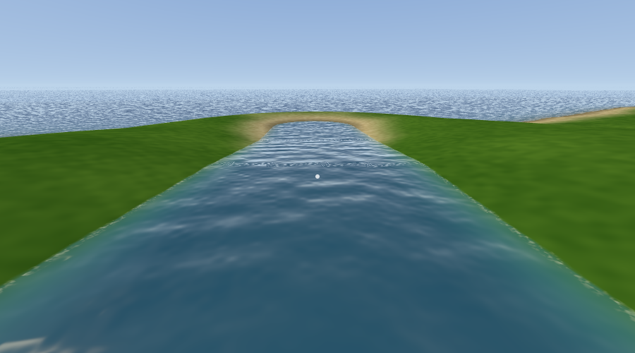
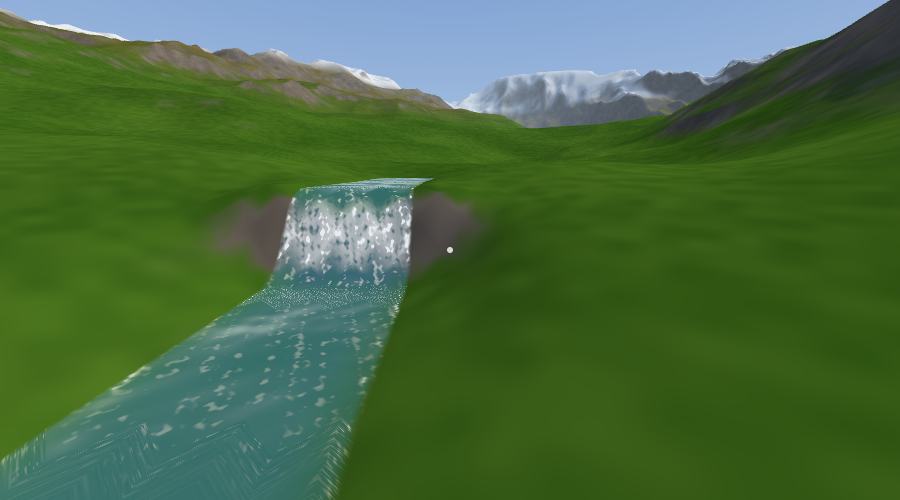
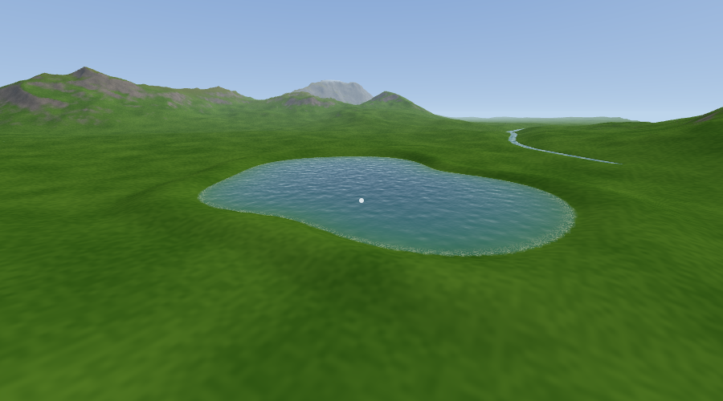

# 🏗️ ইঞ্জিনিয়ারিং ভিজ্যুয়াল সিটি

একটি **১০০% বাংলা** ওপেন-ওয়ার্ল্ড গেম (ব্রাউজারে চলে), যেখানে খেলতে খেলতে **সিভিল, মেকানিক্যাল ও ইলেকট্রিক্যাল ইঞ্জিনিয়ারিং** শেখা যায়।
পুরো গেম, মেনু, লেখা ও ভয়েস বাংলায়।

> **অবস্থা: ধাপ ৫ + হেলিকপ্টার (প্রিভিউ)।** এখন আছে: ১০ কিমি × ১০ কিমি বিশাল মানচিত্র, পাহাড়-সমতল, সাগর, নদী, হ্রদ, ঝরনা, আকাশ-সূর্য-ছায়া, **খেলোয়াড় (ইঞ্জিনিয়ার)** (হাঁটা, দৌড়ানো, লাফানো, সাঁতার) এবং **চালানো যায় এমন গাড়ি**: সেডান (RWD) ও জিপ (৪×৪), বাস্তব ইঞ্জিন-গিয়ারবক্স-সাসপেনশন-ব্রেক ফিজিক্স, ইঞ্জিন কার্ভ দেখানো ড্যাশবোর্ড।
> রাস্তা, ভবন, মানুষ-পশু, ইঞ্জিনিয়ারিং সিস্টেম ও মিশন পরের ধাপগুলোতে আসবে।

**পুরো মানচিত্রের এলাকা-ভাগ ও রেলওয়ে পথ (ধাপ ১১ক + ১১খ):** ১০×১০ কিমি মানচিত্রের প্রতিটি বিন্দু এখন একটি নামযুক্ত বাস্তব-জগতের মতো এলাকায় পড়ে: নগর কেন্দ্র, আবাসিক, বাণিজ্যিক, শিল্প, লজিস্টিক, শিক্ষা, সরকারি-স্বাস্থ্য, ইউটিলিটি, **বিমানবন্দর** (২ কিমি রানওয়ে, টার্মিনাল, কার্গো, হ্যাঙ্গার), **সমুদ্রবন্দর** (কন্টেইনার, বাল্ক, তেল, মাছের ঘাট, জাহাজ-বেসিন), কৃষিজমি, গ্রাম, বন, পাহাড়, হ্রদ-জলাভূমি, সমুদ্রসৈকত, সাফারি পার্ক ও সাগর। যেখানে দাঁড়াবে সেখানকার এলাকার নাম স্ক্রিনের চিপে দেখাবে এবং মিনি-ম্যাপে (N চেপে বড় করো) রঙে দেখা যাবে। **রেলওয়ে নেটওয়ার্ক:** ৮টি স্টেশন এলাকা ও ১২টি লাইনের পথ ঠিক করা আছে: কেন্দ্রীয় স্টেশন থেকে ছড়ানো ৮টি এবং স্টেশনগুলোকে সরাসরি জোড়া ৪টি বলয় লাইন, যাতে কেন্দ্রে না এসেই এক এলাকা থেকে অন্য এলাকায় যাওয়া যায় (কেন্দ্রীয় স্টেশন থেকে উত্তর শিল্পনগর, বিমানবন্দর, পূর্ব শিল্পাঞ্চল, বন্দর, নতুন শহর ও উত্তর-পশ্চিম উপশহর)। এখনও লাইন বা ট্রেন বসেনি; **৪** চাপলে পরিকল্পিত পথ, স্টেশন এলাকা ও রাস্তা-রেল ক্রসিং (লাল = রাস্তা ওপর দিয়ে ফ্লাইওভার, নীল = রেল ওপর দিয়ে, রাস্তা নিচ দিয়ে, বেগুনি = সুড়ঙ্গ) দেখা যায়।

**শহরের স্থানীয় সড়ক (ধাপ ১০খ, প্রথম ধাপ: কেন্দ্রীয় শহর):** কেন্দ্রীয় শহরের প্রতিটি এলাকায় (CBD, আবাসিক, বাজার, ক্যাম্পাস, হাসপাতাল ইত্যাদি) এখন নিজস্ব রাস্তার জাল আছে। রাস্তার ব্লকগুলো মূল সড়কের দিক বরাবর সাজানো, মূল সড়কের সাথে ঠিকমতো T-মোড়ে যুক্ত, পানি বা সেতুর ওপর দিয়ে যায় না। ফুটপাত, কার্ব ও (৪-লেনে) মাঝের দাগ আছে। এই ধাপে এখনও আসেনি: রাস্তার বাতি, রাউন্ডঅ্যাবাউট, সাইট ১ ও ২-এর রাস্তা এবং ভবন।

**মানুষ ও চালকসহ গাড়ি (ধাপ ৯):** মানচিত্রে আর আগে থেকে রাখা খালি গাড়ি নেই। প্রতিটি গাড়ির একজন চালক (মানুষ) আছে, বাঁ-হাতি ট্রাফিকে (বাংলাদেশের মতো) রাস্তার বাঁ লেনে চলে, মোড়ে সোজা/বাঁয়ে/ডানে যায়, মানুষ বা সামনের গাড়ি দেখলে থামে। রাস্তার ধারে ও খোলা জায়গায় মানুষ হাঁটে। **গাড়ি নিতে:** গাড়ির সামনে দাঁড়াও (চালক থেমে যায়), পাশে গিয়ে **F** — চালক ডান দরজা দিয়ে নেমে দৌড়ে সরে যায়। তুমি নেমে হেঁটে সরে গেলে খালি গাড়িটি মুছে যায়।

**হাঁটার সময়:** W A S D চলা · Shift দৌড় · Space লাফ · মাউস ঘোরানো · হুইল জুম · পানিতে Space/C উপরে/নিচে · **F গাড়িতে ওঠা (গাড়ির ৪ মিটারের মধ্যে)**

**গাড়ি চালানোর সময়:** W গ্যাস · S ব্রেক/পিছনে · A D স্টিয়ারিং · Space হ্যান্ডব্রেক · E/Q গিয়ার উপরে/নিচে (ম্যানুয়াল) · G অটো/ম্যানুয়াল · **I ইঞ্জিন কার্ভ (টর্ক ও ক্ষমতার লাইভ গ্রাফ)** · R গাড়ি সোজা করা · F নামা (গাড়ি থামিয়ে)

**হেলিকপ্টার (স্পনের কাছে পার্ক করা, কাছে গিয়ে F):** **H** ইঞ্জিন চালু/বন্ধ (রোটর পুরো গতি পেতে ~৬ সেকেন্ড) · **Space** উপরে · **C** নিচে · **W S** সামনে/পিছনে · **A D** বাঁয়ে/ডানে হেলা · **Q E** নাক ঘোরানো · **Shift** দ্রুত গতি · **X** সহায়ক (অটো-স্থির) ↔ ম্যানুয়াল · **N** বড় মানচিত্র · **R** সোজা করা · **F** নামা (মাটিতে নেমে)। সব উড়ার সময় ডান-উপরে ১০ কিমি × ১০ কিমি মানচিত্রে নিজের অবস্থান, দিক ও শহর-এলাকা দেখা যায়।

**অস্ত্র (ধাপ ১০ক+):** হাঁটার সময় **বাম মাউস** গুলি (SMG ধরে রাখলে স্বয়ংক্রিয়) · **ডান মাউস** টার্গেট (ক্যামেরা কাছে আসে, নিশানা নিখুঁত) · **Q** পরের অস্ত্র (পিস্তল → এসএমজি → শটগান) · **R** রিলোড (ম্যাগাজিন খালি হলে নিজে নিজেই রিলোড হয়)। প্রতিটি অস্ত্রের ম্যাগাজিন ও অতিরিক্ত গুলি আছে (ডান-নিচে দেখা যায়); বন্দুকধারী মানুষ মারলে তার অস্ত্রের গুলি পাওয়া যায়। কিছু মানুষের কাছে বন্দুক আছে, তারা তোমাকে দেখলে গুলি করে; তুমি মরবে না। মানুষ মারলে ওয়ান্টেড তারকা বাড়ে ও পুলিশ আসে।

**ডিবাগ:** V ফ্রি-ক্যামেরা · T প্লেয়ারকে ক্যামেরার জায়গায় আনা · F3 ডিবাগ প্যানেল · M ভয়েস বন্ধ/চালু

| নদী | ঝরনা | হ্রদ |
|---|---|---|
|  |  |  |

## ▶️ অনলাইনে প্রিভিউ (GitHub Pages)
১. GitHub এ নতুন repository বানাও (নাম যেমন `engineering-visual-city`) এবং এই ফোল্ডারের সব ফাইল push করো (branch: `main`)।
২. Repository → **Settings → Pages → Build and deployment → Source: GitHub Actions** বেছে নাও (একবারই)।
৩. **Actions** ট্যাবে "Deploy to GitHub Pages" শেষ হলে গেম চালু হবে এই ঠিকানায়:
   `https://<তোমার-ইউজারনেম>.github.io/<repo-নাম>/`

প্রতিবার `main` এ push করলে নিজে নিজেই নতুন সংস্করণ প্রকাশ হয়।

```bash
git init
git add .
git commit -m "ইঞ্জিনিয়ারিং ভিজ্যুয়াল সিটি - ধাপ ৩"
git branch -M main
git remote add origin https://github.com/<ইউজারনেম>/<repo-নাম>.git
git push -u origin main
```

## 💻 নিজের কম্পিউটারে চালানো
`npm install` তারপর `npm run dev` (Node 20+ লাগবে), ব্রাউজারে http://localhost:5173 খোলো। স্ক্রিনে ক্লিক করলে মাউস ধরবে।
**ভালো পারফরম্যান্সের জন্য ডিভাইসের GPU চালু আছে এমন ব্রাউজার (Chrome/Edge/Firefox) ব্যবহার করো।**
প্রথমবার লোড হতে কয়েক সেকেন্ড লাগতে পারে। বাংলা ভয়েসের জন্য `public/assets/voice/bn/` দেখো।

---

# Technical documentation (English)

## Run (details)
```bash
npm install
npm run dev        # http://localhost:5173
npm run build      # type-check + production build
```
Needs Node 18+ and a WebGL2 browser. Click the screen to capture the mouse.

| Key | Action |
|---|---|
| W A S D | move (relative to the camera) |
| Shift | run (swim faster in water) |
| F | get into / out of a vehicle (within 4 m; stop first to get out) |
| Space | jump (in water: swim up) |
| C | in water: swim down |
| Mouse | orbit the camera around the player |
| Mouse wheel | zoom 2.5 - 25 m |
| V | switch player camera <-> free-fly debug camera |
| T | (free-fly) bring the player to the camera position |
| 1 / 2 | terrain wireframe / LOD colours |
| F3 | debug panel |
| M | voice on/off |
| Esc | release mouse |

In free-fly mode: W A S D move, Space/E up, Q/C down, Shift boost, wheel = speed.

## People & traffic (`src/people/`, `src/traffic/`) - Stage 9
Rule: **a vehicle never exists without a driver.** `VehicleManager.spawn(spec, pos, yaw, driver)` needs a `Person` (or `'player'`); nothing is placed by hand any more.
- `PersonModel` / `Person`: procedural people with random looks (skin, shirt, trousers, cap / topi); seated pose for drivers; no physics body (snapped to the ground / road profile).
- `PeopleManager`: 34 people around the player - walking along road edges (never on bridges or inside junction pads), wandering in the open (never in water or on asphalt), standing around, running from a fast car. Appear 40-190 m away, removed beyond 240 m.
- `RoadGraph`: position along a road spline, lane offset (**left-hand traffic**), junction "stations" (where a road meets a pad), ring sampling of roads around a point.
- `RouteBuilder`: builds the path ahead of a car in 5 m steps; at a junction pad it picks straight / left / right (no U-turns) and joins the other road with a Bezier curve; a road that just ends is a dead end (the car stops there, then is removed). Bend speed limit v = sqrt(2.2 / curvature).
- `AIDriver`: pure-pursuit steering + target-speed controller (road limit, bends, braking distance 3.2 m/s^2, dead end) + stops for people / vehicles in front of the bumper (a deadlock breaker lets one of two facing cars go after 7 s). Produces the same `DriveInput` as the keyboard (plus analogue `throttleAmt` / `brakeAmt`).
- `TrafficManager`: 12 AI cars around the player (110-260 m away, on roads, physics colliders present), removes cars that are far, flipped, stuck or at a dead end - **together with their driver**.
- Taking a car: stand in front of it so the driver stops, go next to it (<= 4 m) and press **F**: the driver steps out of the right-hand door (right-hand drive) and runs away. When you get out, the empty car is removed as soon as you are 30 m away (or after 90 s).
- The helicopter is still parked without a pilot (not part of this step).
- Test: `npm run test:people` (headless, real Rapier): routes, junction turns, lane keeping, stopping for a person, getting in/out, no empty vehicles, crowd behaviour.

## Local streets (`src/roads/LocalRoads.ts`) - Stage 10B, step 1 (city site 0)
`Config.roads.activeTier = 4`. Tier 4 = the street grids of the planned city areas (`CityPlan` `grid`), built for the sites listed in `Config.city.localRoads.sites` (now `[0]`; sites 1 and 2 follow).
- **Lattice per area**: block size / half width / lanes / speed come from the area grid. The lattice is rotated to the tier-1 roads at the site hub (circular mean of 4 x angle) and offset by half a block, so the area centre is a block centre and even small areas get a full block ring.
- **Validation**: a street piece is kept only if all of it lies inside its area (6 m margin), on dry ground (carriageway + both footpaths), at least `clearMain` / `clearLocal` away from other asphalt, outside the keep-out of tier 1-3 junction pads and bridges, and gentler than 6 %.
- **Connections**: street groups are joined by straight connectors to another group or as a ~90 degree T-junction to a vertex of a tier 1-3 road (spacing 120 m along the road); extra connectors link nodes beside a main road. A group that cannot be joined is removed, so every street is reachable from a main road.
- **RoadSpec**: every street is a real spline (`tier 4`, kind `local`, `areaId`), so mesh, physics, minimap, `RoadGraph`, traffic and people use it unchanged. Straight runs are merged into one spline; the surface is linear between junction heights (`buildLocalProfile`).
- **Junction pads** (`Junctions.ts`): legs of local streets only need `localRoads.minArm` (40 m); local-local pad spacing 48 m, local-main 76 m; a pad between local streets is tilted to fit its streets (<= 6 %), a T onto a main road keeps a 28 m level stub.
- **Look** (`RoadMaterial`): local streets are flagged in the vertex data; kerb + concrete footpath (2 m, `Config.city.localRoads.sidewalk`) instead of the gravel shoulder; a centre line only on 4-lane streets.
- Tests: `npm run test:local-roads` (reachability from a freeway, no overlap, no water / bridge, widths, grades, no skipped pad, AI routes through the grid).
- **Not yet done in 10B**: street lamps (instanced), roundabouts, streets for sites 1 and 2.

## Vegetation (`src/vegetation/`) - Stage 7: trees, rocks, grass
- **Placement** (`TreePlacement.ts`, runs in `chunk.worker.ts`): the world has a fixed 10 m grid of cells (`Config.vegetation.cellSize`), every cell has its own random stream, so a tree is always at the same spot whatever chunk or LOD asks for it. A noise field makes forests (`forestChance`) with a few scattered trees between (`scatterChance`). A tree is dropped in water, on the beach, on slopes over 33 degrees, within 4 m of asphalt / shoulder / junction pads, above the tree line (230-330 m) and inside planned city areas (only `green` / `recreation` zones get trees, `Config.vegetation.cityZoneChance`; the forest grows back over 150 m outside a city plan).
- **Kinds**: broadleaf (default), pine (from 70 m up, all pine from 150 m), palm (below 35 m, patchy). Scale and colour tint vary per tree.
- **Rendering** (`TreeAssets.ts`, `TreeChunkBuilder.ts`): every kind is one merged low-poly geometry with vertex colours, drawn as an `InstancedMesh` per chunk and kind (a few draw calls per chunk). LOD0 chunks use the detailed models and cast shadows, LOD1 chunks (`Config.vegetation.maxLod`) use simple models, farther chunks have no trees. Trees are parented to the chunk group, so they load / unload / dispose with the chunk and appear after the terrain has faded in. Wind sway is a vertex-shader tweak (`windStrength`).
- **Collision** (`TreePhysics.ts`): trunks only (Rapier cylinders, up to 5 m high; crowns do not collide). Trees are grouped in 50 m squares, one fixed body per square; a square gets its body when it is within 80 m of the player and loses it beyond 110 m (max 8 squares per 5 Hz update, so walking into a forest does not hitch). Works for the player controller and vehicles (plain fixed colliders), follows the floating origin like the other bodies. `chunk:loaded` now carries `trees`.
- **Check**: `npm run test:trees` (no tree in water / on roads / on steep ground / in built-up areas, deterministic, speed) and `npm run test:tree-physics` (real Rapier: ray hits trunk, character is stopped, origin shift, removal / reload / unload, no leaked colliders).
- **Rocks** (`RockPlacement.ts`, `RockAssets.ts`): same grid method as trees (20 m cells), in clumps; more on steep ground (outcrops, rise/run 0.35-0.8) and above the tree line; many small stones, few boulders (scale 0.4-2.5). Two kinds: round (lumpy boulder) and slab (flat stone). Not in water, on beaches, within 5 m of roads or in built-up city areas. Rendered with the trees (same `InstancedMesh` group). Rocks tall enough to matter (`rocks.collideMinHeight` 0.45 m) get collider cylinders in `TreePhysics`; smaller ones can be walked over.
- **Grass** (`GrassPlacement.ts`, `GrassAssets.ts`, `GrassManager.ts`): tufts (7 blades each) on a fine 0.8 m grid in 32 m tiles around the player, NOT per chunk. `GrassManager` asks the chunk workers for the tiles within 64 m (`'grass'` messages, `ChunkLoader.requestGrass`), builds one `InstancedMesh` per tile and removes tiles beyond 90 m. Meadows with bare patches, thinner in forests; none on water, beach, roads, ground steeper than 0.45 (the terrain shader turns to rock at ~0.5) or above 300 m; half as many inside city plans; colour goes green to dry with height like the terrain shader. The vertex shader sways the blades and shrinks tufts to nothing between 38 and 60 m from the camera, so tiles never pop. No grass is made while the camera is more than 70 m above the ground (free-fly / helicopter). No collision, no shadows.
- **Check**: `npm run test:grass-rocks` (placement rules for rocks and grass, determinism, speed, rock collision with real Rapier, the grass tile manager with a fake worker).
- **Not yet done in Stage 7**: street trees (city), bamboo / bushes, flowers. Not yet seen on a real GPU in tests: check the browser console for shader errors after pulling this stage.

## Helicopter (`src/aircraft/`)
One Rapier dynamic body (cabin + tail boom + skid colliders). The rotor is modelled as forces, not custom collision physics:
lift = collective x Tmax x (rotor speed)^2 x air density x ground effect x translational lift, along the rotor axis (fixed to the fuselage);
tilting the fuselage (cyclic) turns part of the lift into forward / sideways force; pitch/roll torque from the cyclic and yaw torque from
the tail rotor, all scaled by rotor speed; anisotropic drag (side / vertical / forward drag areas); air gets thinner with altitude
(service ceiling 2600-3200 m). Rotor spools up in ~6 s after `H`.
- **Assist (X, default)**: attitude hold (PD controller on pitch/roll, yaw-rate hold) + vertical-speed hold = hover hands-off, soft landing near the ground.
- **Manual**: controls command angular accelerations and the collective directly, plus main-rotor torque reaction. Hard, like the real thing.
- Cruise ~260 km/h, Shift (boost) ~330 km/h: crossing the 10 km map takes about 1.5 minutes. Invisible wall at the map edge.
- `HelicopterManager` (enter/exit, keys, parked ones freeze when far away), `HelicopterHUD` (artificial horizon + instruments), `HelicopterAudio` (procedural rotor sound).

## World (10 km x 10 km)
- Playable area x,z in [-5000, +5000] m, (0,0) = centre = spawn. **North = -z, South = +z.**
- Chunk = 500 m -> exactly **20 x 20 chunks**. 2 extra chunk rings are rendered outside the edge so you never see a void.
- Everything is procedural from `Config.world.seed`. Nothing is stored on disk.
- Terrain: rolling hills, flat plains, ridged mountain ranges (up to ~650 m, snow above ~340 m), a mountain rim along the
  north/east/west edges, and **sea along the whole southern edge** (sea level = 0, sea floor down to -90 m).
- **3 flat city zones** (600 m flat core, 1200 m blend) are reserved for later stages: site 0 is the spawn/centre,
  the other two are seed-generated. See `TerrainGenerator.sites`.
- The free-fly camera is kept inside the world and above the ground.

## Architecture
```
src/
  core/         Config, EventBus, Time, GameLoop, Engine
  world/        WorldManager, ChunkManager (streaming + LOD + fade), ChunkLoader (worker pool),
                FloatingOrigin, LOD, Seed, WorldGrid
  terrain/      Noise (seeded Perlin/fBm/ridged), TerrainGenerator (the height function),
                TerrainMeshData (vertex buffers, skirts, indices), TerrainMaterial (procedural shader),
                TerrainChunkBuilder, TerrainPhysics (Rapier heightfields),
                RiverNetwork (rivers + waterfalls), Lakes (lakes + ponds)
  water/        WaterMaterial (shader), WaterChunkBuilder, HorizonSea
  environment/  Environment (sky dome, sun + shadows, ambient light, fog)
  workers/      chunk.worker.ts, messages.ts
  physics/      PhysicsWorld, PhysicsConfig
  camera/ input/ ui/ utils/
  vegetation/ buildings/ roads/ vehicles/ characters/ animals/ engineering/ missions/   (placeholders)
```

### One height function for everything
`TerrainGenerator.heightAt(x, z)` is a pure function of world position + seed. Workers use it for meshes,
the main thread uses it for the camera and Rapier colliders use the same data. Because every LOD samples the same
function, chunk borders of the same LOD match exactly (verified: 0.00 m difference, identical normals).

### Chunk LOD and seams
4 levels: 128 / 64 / 32 / 16 cells per 500 m chunk side, used up to 700 / 1400 / 2600 / 4500 m
(distance to the nearest chunk edge, 8 % hysteresis). Cracks between different LODs are hidden with **skirts**:
a strip hanging 8 / 16 / 32 / 64 m below each border. Worst measured mismatch LOD0 vs LOD3 is 0.14 m.
Normals are computed with a padded border so lighting is continuous across chunks.

### Streaming without hitches
`evaluate()` (every 32 m) -> queue nearest-first -> max 10 requests in the Web Workers -> `integrate()` adds at most
**2 chunk meshes per frame**. New chunks fade in with a dithered fade (0.7 s). LOD swaps of already visible chunks are instant.
Exponential fog (~95 % at the 4.5 km load radius) hides the far edge.

### Terrain look
Procedural shader (no texture files): grass on flat ground, dry grass higher up, rock on steep slopes and high
altitude, sand near the sea, wet dark seabed below sea level, snow on peaks. Detail noise is **triplanar** so cliffs
do not stretch. Lighting, shadows and fog come from three.js (MeshLambertMaterial + injected colour code).
Shadows are near-only (350 m box following the camera, snapped to texels to avoid shimmering).

### Physics
Rapier heightfield colliders exist only for chunks within **300 m** of the player and are removed when you move away
(verified against the terrain function: 0.00 m error). Floating origin: when the camera is > 2 km from the scene origin
the origin re-centres, bodies shift automatically (`origin:shift`).

## Water (Stage 3): rivers, lakes, waterfalls, sea
Everything is carved into the same height function, so meshes, Rapier colliders and the camera always agree.
`TerrainGenerator.sample(x, z, out)` returns the ground height **and** the water surface level + flow velocity.
Water is visible wherever `ground < water level`, so water can never hover over land.

- **Rivers (`terrain/RiverNetwork.ts`)** - built once from the seed (every worker builds the identical network, ~0.2 s):
  1. natural terrain is sampled on an 80 m grid and blurred;
  2. *priority-flood* fills pits so every cell drains downhill to the sea (this is how real drainage works);
  3. cells that collect enough rain (drainage area) become rivers, small streams merge into bigger ones (tributaries);
  4. paths are smoothed; the water surface height never rises downstream; width and depth grow with drainage area
     (streams ~7 m wide, the main river ~50 m);
  5. around each river a channel + valley is cut into the ground (bed, banks, gentle valley sides).
  If a river would need a gorge deeper than 22 m it ends in a small pond instead.
- **Waterfalls (ঝরনা)** - up to 12 well-spaced drops of 6-28 m in the hills (1-2 steps each). Steeper reaches stay as fast
  cascades. The shader adds foam on steep water, so falls and rapids turn white automatically.
- **Lakes (`terrain/Lakes.ts`)** - 3 lakes on flat ground away from rivers and cities, organic shorelines. A lake is a smooth
  bowl that *replaces* the ground inside the shoreline.
- **Sea** - the sea is part of the chunk water meshes (shoreline foam, depth colour) plus a big ring (`HorizonSea`)
  for the endless horizon.
- **Water mesh (`terrain/TerrainMeshData.ts` -> `water/`)** - built in the worker on the same grid as the terrain; only quads
  touching water are emitted. Per-vertex depth makes the edges transparent, per-vertex flow animates ripples downstream.
- **Water shader (`water/WaterMaterial.ts`)** - animated ripples (scroll with the current), fresnel sky reflection,
  sun glint, depth colour, shore/waterfall/rapid foam, fog. Same material for river, lake and sea.
- **For later stages:** `terrain.sample(x, z, out)` gives water level + flow anywhere (boats, buoyancy, bridges, dams,
  water supply). `terrain.rivers.segments` lists every river segment (position, width, water level) - bridges (Stage 6)
  and water-engineering missions can read it.

Debug panel (F3) shows river count/length, lakes/ponds and waterfall steps. Fly low over the main river to its mouth in the south.

## Player and camera (Stage 4)
- **Player (`characters/Player.ts`)**: a Rapier kinematic capsule (1.8 m x 0.35 m radius) driven by **Rapier's
  KinematicCharacterController** - collisions, slopes (max 55 deg), steps up to 0.5 m and snap-to-ground are all Rapier,
  we wrote no collision code. Real gravity (9.81 m/s^2), jump ~1.4 m, walk 4.2 m/s, run 8.5 m/s.
- **Water**: wading in shallow water is slower; deeper than 1.25 m the player swims (buoyancy keeps the body at the surface
  using `terrain.sample()` water level, Space up / C down, 2.6 m/s, sprint 4.4). Hysteresis stops flip-flopping at the shore.
- **Safe spawn**: the player waits (Bangla "loading" message) until the ground collider under it exists, so it can never fall
  through an unloaded world. Extra safety: it is never allowed more than 1.5 m below the analytic terrain height.
- **Invisible wall** at the edge of the playable area (x, z = +-5000 m, also in the sea).
- **Smooth rendering**: physics runs at a fixed 60 Hz; the model and camera are interpolated, so 120/144 Hz screens look smooth.
- **Orbit camera (`camera/OrbitCamera.ts`)**: mouse orbits, wheel zooms; a Rapier ray from the player to the camera pulls
  the camera in so it never goes through terrain, and it stays above ground and water.
- **Model (`characters/PlayerModel.ts`)**: procedural engineer (yellow helmet, orange vest) with walk, run, jump and swim
  animation, no asset files. Replace later by a real model with the same interface.
- Floating origin: the player's body, model and interpolation state shift together on `origin:shift` (tested at 2600 m).
- Free-fly camera (V): the player is frozen, so nothing falls while you fly around. T teleports the player to the camera.

## Vehicles (Stage 5)
Two drivable vehicles are parked next to the spawn point: a **sedan** (rear-wheel drive, 1250 kg, ~100 kW) and a **jeep**
(4x4, 1750 kg, high clearance, diesel-like torque). Walk up to one and press **F**.

**What Rapier does** (`vehicles/Vehicle.ts`): the dynamic rigid body, Rapier's raycast vehicle controller (spring + damper
suspension per wheel, tyre friction, brakes, steering) and all collisions with the terrain heightfields.
**What we model on top** (`vehicles/Powertrain.ts`, the mechanical-engineering part):
- **Engine** with a real torque curve (Nm vs rpm), idle, redline and **rev limiter**; power = torque x angular speed.
- **Clutch**: slips at low speed so the car can pull away; opens during gear changes (no torque reaches the wheels).
- **Gearbox**: 5 gears + reverse, **automatic** (shifts by rpm, kick-down) or **manual** (E / Q, G toggles).
- **Final drive + differential**: wheel force = engine torque x gear ratio x final drive x efficiency / wheel radius.
  Sedan: open differential (equal torque to both rear wheels). Jeep: 4x4 with a fixed 40/60 front/rear split.
- **Engine braking** when you lift off the gas, **aerodynamic drag** (Cd x frontal area x v^2), **rolling resistance**.
- **Brakes + handbrake** (locks the rear wheels and lowers their side grip, so the tail slides).
- **Steering** lock shrinks with speed and is limited to what the tyres can grip (~1.6 g).
- Low centre of mass, per-vehicle mass/inertia. The **jeep climbs ~26 deg slopes, the sedan cannot** (RWD, low clearance).

**Measured in headless tests** (flat ground): sedan 0-100 km/h in 9.4 s, 100->0 km/h braking ~1 g, stable up to full lock
at 144 km/h; jeep 0-100 in 9.8 s; no vehicle fell through the terrain on real hills.

**Dashboard (all Bangla):** speedometer, RPM dial with redline, gear, auto/manual, throttle and brake bars. Press **I** for
the **live engine curve**: torque and power curves with a dot for the current rpm, the total gear ratio, the force at the wheels,
and a one-line lesson that changes with what the drivetrain is doing (clutch slip, rev limiter, shifting, engine braking...).

**Other details**
- Only vehicles within 300 m of the player are simulated; farther ones are frozen (there is no ground collider there).
- Chase camera: mouse orbits; if the mouse is idle the camera swings behind the car while driving.
- A new vehicle = a new `VehicleSpec` in `vehicles/VehicleSpec.ts` (mass, suspension, engine curve, gear ratios, ...).
- The player's collider is removed while driving, and the player steps out next to the driver's door.
- Rapier quirks handled in code: the brake is ignored on a wheel that has engine force (so drive is cut while braking), and
  `currentVehicleSpeed()` uses the wrong axis by default (we compute the signed speed ourselves).

## পরিষ্কার স্ক্রিন ও সাইট ম্যাপ (Clean screen + site map)
- **স্ক্রিনে কোনো নির্দেশনার লেখা নেই।** শুধু আসল গেম-ডেটা দেখা যায়: গাড়ির স্পিডোমিটার/আরপিএম/গিয়ার, হেলিকপ্টারের যন্ত্রপাতি,
  আর সাইট ম্যাপ। মাউস ধরা না থাকলে মাঝখানে একটা প্লে-আইকন, লোড হওয়ার সময় একটা ছোট স্পিনার, আর ওঠার মতো গাড়ি/হেলিকপ্টারের
  উপর একটা পালসিং আইকন (লেখা ছাড়া) দেখা যায়।
- **সাইট ম্যাপ সব সময় ডানদিকের উপরে** (হেঁটে, গাড়িতে বা হেলিকপ্টারে, সব অবস্থায়)। উত্তর উপরে। দেখায়: সাগর, নদী, হ্রদ, পাহাড় (ছায়াসহ),
  প্লে-এরিয়ার সীমা, শহরের জায়গা (হলুদ বৃত্ত), তুমি (লাল তীর + দেখার কোণ), পার্ক করা গাড়ি ও হেলিকপ্টার।
  ম্যাপের ছবি Web Worker এ একবার আঁকা হয় (`workers/minimap.worker.ts`), তাই গেম থামে না।
- **কী-গুলো** (স্ক্রিনে লেখা নেই, তাই এখানে): `N` ম্যাপের জুম বদলায় (কাছে / মাঝারি / পুরো দুনিয়া), `F` গাড়ি/হেলিকপ্টারে ওঠা-নামা,
  `I` ইঞ্জিন কার্ভ দেখানো (গাড়িতে), `F3` ডেভেলপারদের ডিবাগ প্যানেল (শুরুতে লুকানো), `M` ভয়েস বন্ধ/চালু।

## বাংলা ভাষা নীতি (গেম ১০০% বাংলা)
- **কোড ইংরেজিতে, গেমের সব লেখা ও কণ্ঠ বাংলায়।** প্লেয়ার যা দেখে/শোনে (মেনু, HUD, তথ্য কার্ড, মিশন, ইঞ্জিনিয়ারিং ব্যাখ্যা, ডিবাগ প্যানেল) সব `src/i18n/bn.ts` থেকে আসে। কোডের ভেতরে সরাসরি লেখা নিষেধ।
- **সংখ্যা** বাংলা অঙ্কে দেখানো হয়: `bnNum()`, `bnSigned()` (`src/i18n/index.ts`)। একক: মি, মি/সে ইত্যাদি।
- **ফন্ট:** Noto Sans Bengali প্রজেক্টের ভেতরেই বান্ডল করা (`@fontsource`), ইন্টারনেট ছাড়াও চলে। সব UI `src/ui/theme.ts` এর `UI_FONT` ব্যবহার করে।
- **৩ডি জগতে বাংলা লেখা (সাইনবোর্ড, লেবেল):** three.js TextGeometry ব্যবহার করা যাবে না (যুক্তাক্ষর ভেঙে যায়)। HTML/CSS ওভারলে অথবা Canvas থেকে বানানো টেক্সচার ব্যবহার করতে হবে (ব্রাউজার ঠিকভাবে বাংলা শেপিং করে)।
- **ভয়েস:** `VoiceManager.speak('id')` এই ক্রমে চেষ্টা করে: (১) `public/assets/voice/bn/<id>.mp3` রেকর্ড করা কণ্ঠ, (২) ব্রাউজারের বাংলা TTS, (৩) শুধু সাবটাইটেল। সাবটাইটেল সবসময় দেখানো হয়। `M` চাপলে ভয়েস বন্ধ/চালু। প্রকৃত বাংলা কণ্ঠের জন্য mp3 ফাইল রাখাই সেরা, কারণ সব ডিভাইসে বাংলা TTS ভয়েস থাকে না।
- ইঞ্জিনিয়ারিং শব্দ: সেতু, বাঁধ, কালভার্ট, ট্রান্সফরমার, সাবস্টেশন, টার্বাইন ইত্যাদি বাংলায়; প্রয়োজনে প্রথমবার বন্ধনীতে ইংরেজি।

## Not done yet (by design)
Roads/bridges (6), vegetation (7), buildings (8),
people/animals/traffic (9), day-night/weather/audio (10), engineering systems (11), UI/save (12), missions (13).

## Known limits
- A LOD swap of an already visible chunk is instant (not morphed); skirts hide cracks, hysteresis keeps swaps rare.
- Water meshes of neighbouring chunks with different LOD can show a hairline gap at the border (rare, only where a river crosses a LOD ring).
- Water has no collider: the player floats using the water level function; vehicles/boats (Stage 5) will use the same function.
- No engine/tyre sounds yet (audio is Stage 10); tyre grip is the same on every surface (no mud/snow/ice yet); no vehicle damage or fuel yet (Stage 12+).
- The player has no footstep/water sounds yet (audio is Stage 10) and no inventory/interaction yet (Stage 8+).
- Third-person camera in tight spaces (inside buildings) will need more work when buildings exist (Stage 8).
- Rivers cut gentle V-shaped valleys (up to ~20 m deep in hilly areas).

## Stage 6C notes: all district links are built
All 19 `DISTRICT_LINKS` of `RoadPlan.ts` are now built (before: only 9, the rest were dropped). What changed in `RoadNetwork.ts`:
- `route()` has a *relaxed* second pass (steeper ground allowed, strongly penalised) when the strict A* finds no path (links that start/end on mountain slopes).
- Loops / spikes in a routed link are cut out (`removeLoops`), so a road never doubles back on itself.
- A link that conflicts with another road is repaired instead of dropped: built from the other end, or split at the crossing so both halves end on that road (T junction), or ended in a village hub (`repairedLinks`).
- Junction nodes are never put on a bridge deck / over water; free ends near the coast are moved to the nearest dry ground (`nearestDry`).
- Minimap (`minimap.worker.ts`) draws every road: freeway orange, primary pale yellow, secondary white, bridges magenta.
- Road shader: freeway / arterial (double yellow centre line) / collector (dashed centre line) each have their own worn-asphalt look.
Tier 4 (local city streets, roundabouts) is still not built (`Config.roads.activeTier` = 3).


## Roads: engineered intersections & rivers (Stage 6E)
- `src/roads/Junctions.ts`: every junction is ONE flat pad (T / 4-way / bend): legs straightened, T-junctions meet at 90 deg, legs >= 60 deg apart,
  kerb-return radius by class (freeway 22 m, arterial 16, collector 12, local 9), terrain levelled to the pad plane, zebra crossing + stop line on minor legs.
- Rivers: every wet crossing is a bridge (also when the river only touches the shoulder); high fill beside a river valley becomes a viaduct;
  wet ground is never filled; the ground can never poke through a bridge deck. Check: `npm run test:rivers` (must print 0 buried cells).

## City master plan (`src/city/CityPlan.ts`) - Stage 10A: which area is for what
Data only - **no building is placed yet**. Each of the 3 flat city sites is divided into AREAS (rectangles / rings in site-local metres, priority order, the last one is a catch-all ring). Every area has: zone kind, density, floors (min, max), the list of building types allowed there and a street grid (block size, road width) for its local roads (Stage 10B). Names are in `bn.city`.
- **Site 0 - Central Metropolis (spawn):** transport plaza in the middle; NE business centre (CBD, skyscrapers); NW government + university; SE dense flats + central bazaar; SW homes + hospital + central park; shop/office strips along the 4 freeway arms; substation, water treatment, stadium south; bus/truck depot north; suburbs and a green belt around.
- **Site 1 - NW satellite town:** town centre; homes (NW), villas (NE), flats (W); engineering university campus (E); hospital + park (S); sports ground (SE); solar farm (far S); suburbs + farmland belt.
- **Site 2 - Industrial + logistics city** (a river splits it): north of the river logistics hub, power plant, heavy industry, workers' flats; south of the river homes, waste + water treatment, light industry / garments; green buffer around.
- The minimap shows the areas in colour (yellow = residential, red = commercial, orange = mixed, purple = industry, blue = government, teal = education, pink = health, grey = utilities, white = transport, green = parks / farmland). A chip at the bottom-left shows the area you stand in.
- `CityPlan.areaAt(x, z)` gives the area at any world position (used by Stage 10B to place roads and buildings).
- Test: `npm run test:city` (names, every building type used, no hidden area, areas dry and flat).

## Guns (`src/combat/`) - shoot people, get shot at, never die
- **Left mouse** = fire (hold for the SMG), **right mouse** = aim (camera comes closer, bullets more accurate), **Q** = next weapon (pistol, SMG, shotgun). Works on foot with the mouse captured. Unlimited ammo, no reload.
- Bullets are hit-scan from the crosshair: first thing hit is terrain / car (Rapier ray) or a person (`rayVsPerson`, cylinder, head = top 16 % = x3 damage). People have 100 health: pistol 3 body shots or 1 headshot. Dead people fall on their back and stay 25 s.
- **Others want to kill you:** 14 % of walking people carry a gun (pistol / SMG / shotgun) and attack when they see you within 55 m (line of sight is checked with a Rapier ray). They run at you, strafe and shoot. Gunshots and bodies make everybody within 38 m run away; armed people close by attack.
- **You can never die.** NPC bullets only flash the screen red and make a thud (`CombatHooks.playerHit`).
- **Wanted level (stars, top centre):** killing a civilian +1, wounding +0.4, hurting / killing police +0.6 / +2; shooting an armed gunman is no crime. Stars fade with time. Police (blue uniform, pistol, SMG from 4 stars) spawn 45-85 m away, 2 per star, and attack; they leave 15 s after the stars are gone.
- Tests: `npm run test:combat` (ray maths, damage, wanted, gunmen attack, police). All numbers: `Config.combat`.


## Stage 11A/11B: world zones + railway plan (English)
- `src/city/WorldZones.ts` - zoning of the WHOLE map: 57 named zones (district seeds, power diagram), airport and seaport with sub-areas, sea from a measured coast table. `getWorldZoneAt(x, z)` never returns "nothing". Names: `bn.worldZones`.
- `src/rail/RailPlan.ts` (stations + lines + design limits), `RailNetwork.ts` (A* router on a 60 m grid: gentle grades, rivers crossed not followed, lakes blocked, then curve smoothing; design height line with 2.5 % max grade; tunnel / bridge segments; road crossings and how each is resolved), `RailDebug.ts` (key 4).
- Crossing rules: road already on a bridge -> rail under it; rail in tunnel -> road stays above; rail on embankment/viaduct -> road underpass; rail in a cutting -> road flyover; city streets -> rail raised on a viaduct; flat land -> road flyover. Never at the same level.
- Checks: `npm run test:zones`, `npm run test:rail`.
- Not built yet (next stages): tracks, stations, tunnels, bridges and flyovers; grading the airport / seaport ground flat; buildings in the zones.
